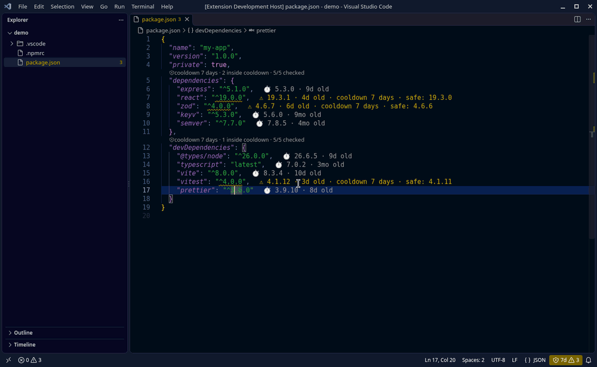
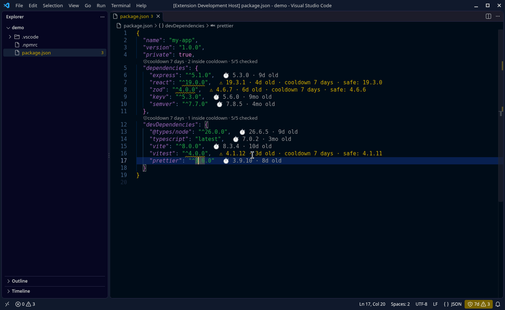
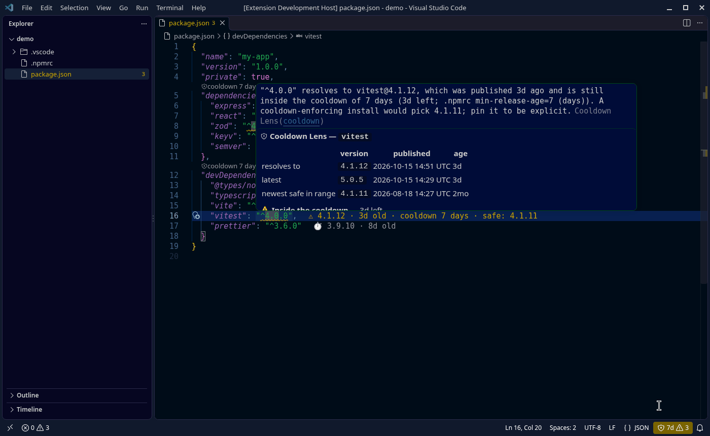
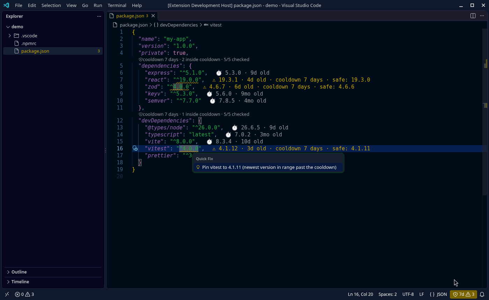

# Cooldown Lens — npm & PyPI package age and minimum release age for VS Code

[](https://marketplace.visualstudio.com/items?itemName=jonirafael.cooldown-lens) [](https://open-vsx.org/extension/jonirafael/cooldown-lens) [](https://www.npmjs.com/package/cooldown-check)

**See how old every dependency version in your `package.json`, `requirements.txt` or `pyproject.toml` is, and catch
versions that are still inside your supply-chain cooldown before you install them.** Cooldown Lens reads the cooldown you
already configured for npm (`min-release-age`), pnpm (`minimumReleaseAge`), Yarn (`npmMinimalAgeGate`), Bun
(`minimumReleaseAge`) or uv (`exclude-newer`), shows the release age inline, raises a warning for every version that is
too fresh, and offers a one-click quick fix to the newest version that passes the cooldown.

**New in 0.2.0:** Python / PyPI support (pip requirements files, PEP 621 / PEP 735 / Poetry `pyproject.toml`, uv
`exclude-newer`) and a **Cooldown Lens: Check All Dependencies** command that scans the whole workspace. Want the same
check in CI? Use the companion CLI on npm: [`npx cooldown-check`](https://www.npmjs.com/package/cooldown-check) ([docs](cli/README.md)).



> Why? Most npm supply-chain attacks (ChainDrop/keyv, Shai-Hulud, Nx, axios…) were detected and unpublished within hours
> to a few days. A **dependency cooldown** (a.k.a. *minimum release age*) simply refuses versions younger than N days.
> See [cooldowns.dev](https://cooldowns.dev/) for background. Your package manager enforces it at install time; Cooldown
> Lens makes it visible while you edit — the editor-side counterpart requested in
> [microsoft/vscode#267385](https://github.com/microsoft/vscode/issues/267385).

## Features

- **Inline package age** for `dependencies`, `devDependencies`, `peerDependencies` and `optionalDependencies`:
  `⏱ 5.3.0 · 9d old`, or `⚠ 19.3.1 · 4d old · cooldown 7 days · safe: 19.3.0`.
- **Diagnostics (warnings)** in the Problems panel for every version still inside the cooldown, including how much time
  is left and where the threshold came from.
- **Quick fix** (`Ctrl+.` / `Cmd+.`): pin to the newest version **in your range** that passes the cooldown, or — if no
  version in the range is old enough — move the range to the newest older safe version.
- **Hover** with resolved/installed version, publish date (UTC), age, latest version, newest safe version, and whether the
  package is exempt.
- **CodeLens** summary above each dependency section and a compact **status bar** item (`🛡 7d ⚠ 3`); with no manifest
  open it shows the workspace-wide count from the last **Check All Dependencies** run.
- **Check All Dependencies** command: scans every `package.json`, `requirements*.txt`, `constraints*.txt` and
  `pyproject.toml` in the workspace (skipping `node_modules`, virtualenvs, `.tox`…), writes a report to the *Cooldown
  Lens* output channel and lets you jump to each too-young dependency.
- **Python / PyPI**: `requirements*.txt` (environment markers, extras, line continuations; option lines such as `-r`/`-c`/`--index-url`, editable,
  URL and local entries are skipped), `pyproject.toml` `[project.dependencies]`, `[project.optional-dependencies]`,
  `[dependency-groups]` and `[tool.poetry.*dependencies]`. Publish dates come from the PyPI JSON API (earliest file
  upload per release); yanked releases are never suggested. Versions are compared with PEP 440 rules.
- **Reads your real cooldown configuration** (see below) — no second source of truth. Falls back to a setting
  (default **7 days**).
- **Honours exclusions**: `min-release-age-exclude`, `minimumReleaseAgeExclude`, `minimumReleaseAgeExcludes`,
  `npmPreapprovedPackages`, plus your own `cooldownLens.excludePackages`.
- **Installed vs. requested**: if `node_modules/<pkg>/package.json` exists, the installed version is checked; otherwise
  the version your range resolves to today (npm semantics: `latest` tag if it satisfies, else highest match).
- **Fast and polite**: in-memory + on-disk cache (default TTL 60 min), request de-duplication and a concurrency limit
  (default 6).
- **Custom registries & offline mode**: point it at a mirror (Verdaccio, Artifactory, Nexus, CodeArtifact…) or work
  fully offline from cache.
- **Secure by default**: https only (http just for `localhost`), never sends credentials or tokens, ignores registry URLs
  from project files in untrusted workspaces, fails closed when a registry omits publish times.

| Overview | Hover | Quick fix |
|---|---|---|
|  |  |  |

## How the threshold is resolved

Cooldown Lens looks for project configuration in the folder of the `package.json` and its parents (up to the workspace
folder). The key names and units below were checked against each tool's official documentation:

| Package manager | File | Key | Unit | Docs |
|---|---|---|---|---|
| npm ≥ 11.10 | `.npmrc` | `min-release-age` | **days** | [npm config](https://docs.npmjs.com/cli/v11/using-npm/config#min-release-age) |
| pnpm ≥ 10.16 | `pnpm-workspace.yaml` | `minimumReleaseAge` | **minutes** | [pnpm settings](https://pnpm.io/settings#minimumreleaseage) |
| pnpm v10 | `.npmrc` | `minimum-release-age` | minutes | [pnpm 10 settings](https://pnpm.io/10.x/settings) |
| Yarn ≥ 4.10 | `.yarnrc.yml` | `npmMinimalAgeGate` | duration (`"3d"`, `"1w"`, `"12h"`); a bare number = **minutes** | [yarnrc](https://yarnpkg.com/configuration/yarnrc#npmMinimalAgeGate) |
| Bun ≥ 1.3 | `bunfig.toml` | `[install] minimumReleaseAge` | **seconds** | [bunfig](https://bun.com/docs/runtime/bunfig#install-minimumreleaseage) |

Examples, all equal to a three-day cooldown:

```ini
# .npmrc
min-release-age=3
```

```yaml
# pnpm-workspace.yaml
minimumReleaseAge: 4320
```

```yaml
# .yarnrc.yml
npmMinimalAgeGate: "3d"
```

```toml
# bunfig.toml
[install]
minimumReleaseAge = 259200
```

Resolution rules:

1. `cooldownLens.thresholdSource: "setting"` → always use `cooldownLens.defaultCooldownDays`.
2. The package manager is detected from `packageManager` / `devEngines.packageManager` in `package.json`, or from the
   lockfile (`package-lock.json`, `pnpm-lock.yaml`, `yarn.lock`, `bun.lock(b)`). If that manager has a cooldown setting,
   it wins (nearest file first).
3. Otherwise the **strictest** cooldown found in any of the files is used (conservative).
4. Otherwise `cooldownLens.defaultCooldownDays` (default `7`). Note: pnpm v11+ and Yarn 4.15+ apply a built-in one-day
   cooldown even without configuration; Cooldown Lens tells you so in the status bar tooltip.

A `pnpm.minimumReleaseAge` field in `package.json` is also read as a low-priority legacy location; current pnpm docs only
document `pnpm-workspace.yaml`. Only project files are read — user-level files such as `~/.npmrc` are not.

### Python

1. A uv cooldown in the nearest `uv.toml` or `pyproject.toml` `[tool.uv]` (up to the workspace folder):
   `exclude-newer = "7 days"` (friendly or ISO 8601 durations such as `P7D`, or an absolute date/timestamp, which is
   converted to a cooldown). `exclude-newer-package = { pkg = false }` exempts a package.
2. Otherwise `cooldownLens.python.minimumReleaseAgeDays`, if set.
3. Otherwise `cooldownLens.defaultCooldownDays`.

```toml
# pyproject.toml
[tool.uv]
exclude-newer = "3 days"
```

Run **Cooldown Lens: Show Effective Cooldown Policy** to see the threshold, its source, the registry and excludes.

## Settings

| Setting | Default | Description |
|---|---|---|
| `cooldownLens.enabled` | `true` | Turn the extension on/off. |
| `cooldownLens.defaultCooldownDays` | `7` | Fallback cooldown when the project has none. |
| `cooldownLens.thresholdSource` | `auto` | `auto` = project config, then fallback; `setting` = always the fallback. |
| `cooldownLens.registry` | `""` | Registry base URL. Empty = project `.npmrc`/`.yarnrc.yml`/`bunfig.toml` (trusted workspaces only), else `https://registry.npmjs.org/`. |
| `cooldownLens.allowInsecureHosts` | `["localhost","127.0.0.1"]` | Hosts that may be reached over plain http. |
| `cooldownLens.offline` | `false` | Never touch the network; use cached metadata only. |
| `cooldownLens.cacheTtlMinutes` | `60` | Freshness of cached registry metadata. |
| `cooldownLens.maxConcurrentRequests` | `6` | Concurrency limit for registry requests. |
| `cooldownLens.requestTimeoutSeconds` | `20` | Per-request timeout. |
| `cooldownLens.dependencyTypes` | all four | Which sections to analyse. |
| `cooldownLens.inlineAges` | `true` | Inline age text. |
| `cooldownLens.codeLens` | `true` | Section summary CodeLens. |
| `cooldownLens.diagnosticSeverity` | `warning` | `error`, `warning`, `information` or `hint`. |
| `cooldownLens.excludePackages` | `[]` | Extra names/globs exempt from the cooldown (e.g. `@myorg/*`). |
| `cooldownLens.python.enabled` | `true` | Analyse `requirements*.txt`, `constraints*.txt` and `pyproject.toml`. |
| `cooldownLens.python.minimumReleaseAgeDays` | `null` | Python cooldown when no uv `exclude-newer` is configured (null = `defaultCooldownDays`). |
| `cooldownLens.python.index` | `https://pypi.org/` | Index exposing the PyPI JSON API (`<index>/pypi/<name>/json`). |
| `cooldownLens.checkAll.maxFiles` | `200` | Maximum manifests scanned by **Check All Dependencies**. |

Commands: **Check All Dependencies**, **Refresh**, **Clear Registry Cache**, **Toggle Inline Package Ages**, **Show
Effective Cooldown Policy**.

## Private registries, mirrors and offline use

- The registry must return the full packument with the `time` field (npmjs, Verdaccio, Artifactory, Nexus and AWS
  CodeArtifact do). Versions without a timestamp are reported as *unverifiable* and never suggested (fail closed).
- Scoped registries (`@corp:registry=https://…` in `.npmrc`) are honoured in trusted workspaces.
- **No authentication is sent.** Registries that require a token will answer 401/403; those packages are shown as
  "registry unavailable" instead of leaking credentials from `.npmrc` to an extension. Use a read-only mirror or exclude
  the scope.
- Registry URLs with embedded credentials, non-http(s) URLs and plain http to non-allow-listed hosts are rejected.
- Offline mode serves everything from the cache stored in VS Code's global storage; on network errors the extension also
  falls back to stale cache entries.

## Cooldown Lens vs. Version Lens

[Version Lens](https://marketplace.visualstudio.com/items?itemName=pflannery.vscode-versionlens) is great at showing
*which newer versions exist*. Cooldown Lens answers a different question: *is this version old enough to trust yet?*
It uses the same cooldown semantics as your package manager, so the editor and `npm install` agree. The two work fine
side by side.

## FAQ

**Does it replace the package-manager setting?** No. Cooldowns must be enforced by the installer (including transitive
dependencies). Cooldown Lens is the visibility layer for direct dependencies in `package.json`.

**Why pin instead of keeping `^`?** A cooldown-unaware install of `^1.2.0` would still pick the fresh `1.3.0`. A pin is the
only edit that changes the result for everyone; once the cooldown has passed, widen it again.

**What about transitive dependencies / lockfiles?** The editor shows direct dependencies. For lockfile-exact and
transitive checks in CI use [`cooldown-check`](cli/README.md) (`npx cooldown-check --all`), which reads
`package-lock.json`, `pnpm-lock.yaml`, `yarn.lock`, `bun.lock`, `uv.lock` and `poetry.lock`.

**Does Python support need Python installed?** No. Everything is parsed in the extension and dates come from PyPI.

## Roadmap

- Lockfile versions inside the editor (already available in the CLI).
- pnpm `catalog:` entries in `pnpm-workspace.yaml`.
- Optional auth via VS Code SecretStorage for private registries.

## Development

```sh
npm install --min-release-age=7   # practice what we preach
npm test                          # unit tests (vitest): config parsers, version selection, registry client
npm run test:integration          # launches VS Code with a fake local registry (needs a display, e.g. xvfb-run)
npm run build                     # esbuild bundle -> dist/extension.js
npm run build:cli                 # esbuild bundle -> cli/dist/cli.js (the cooldown-check CLI)
npx @vscode/vsce package          # -> cooldown-lens-<version>.vsix
```

## License

[MIT](LICENSE) © jonirafael
